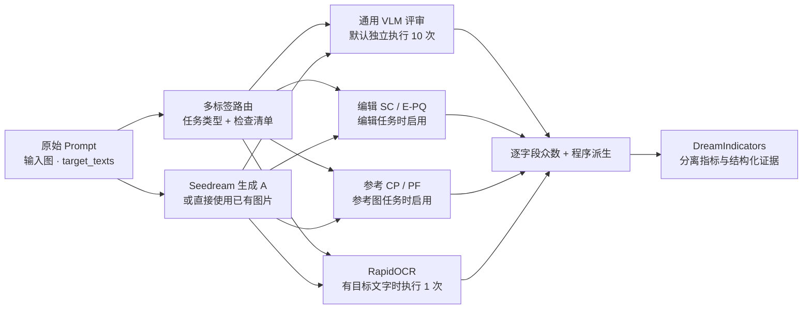
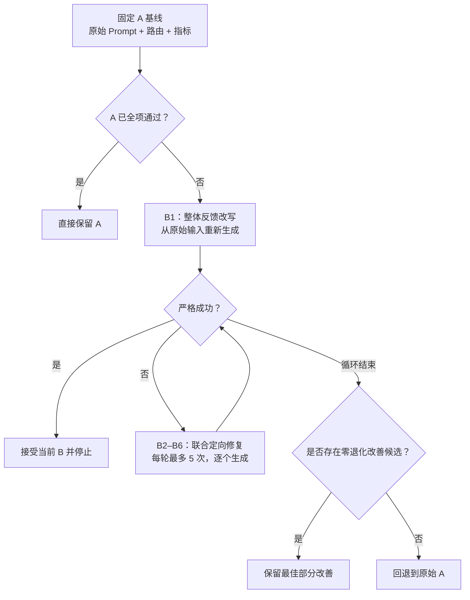

# DreamCycle & DreamIndicators

> 面向 Seedream 的“生成—评估—改写—验收”闭环框架：用多标签路由和可解释的多维评估指导 Prompt 优化，在不降低其他受保护指标的前提下，持续改进图像质量与指令一致性。

**DreamCycle** 负责图片生成、反馈改写、联合修复和最佳候选选择；**DreamIndicators** 负责路由、动态检查项、VLM/OCR 评审、指标聚合与验收。

## 目录

- [核心思路](#核心思路)
- [主要特性](#主要特性)
- [系统架构](#系统架构)
- [DreamIndicators 指标体系](#dreamindicators-指标体系)
- [多轮生成与验收](#多轮生成与验收)
- [快速开始](#快速开始)
- [Web 客户端](#web-客户端)
- [HTTP API](#http-api)
- [输出与结果](#输出与结果)
- [配置说明](#配置说明)
- [部署与持久化](#部署与持久化)
- [项目结构](#项目结构)
- [论文与方法参考](#论文与方法参考)
- [实现边界与注意事项](#实现边界与注意事项)

## 核心思路

原始 Prompt 和 A 的评分标尺保持不变，系统反复执行：

```text
生成图片 → 逐项检查与专项评分 → 找到失败证据
→ 定向改写或联合修复 → 再生图 → 相对原始 A 验收
```

不是简单返回最后一轮结果，而是根据固定指标判断是否接受候选：

- 原始 A 已全项通过：直接保留 A，不继续生成；
- B 严格成功：接受当前图片并提前停止；
- 多轮后只有部分改善：保留最佳的零退化改善候选；
- 没有任何合格改善：回退到原始 A，避免为了变化而变化。

## 主要特性

- **多标签任务路由**：支持文生图、指令编辑、参考图生成及混合任务，OCR 作为可叠加评估项。
- **动态 VQA**：按 Prompt 动态生成对象、属性、数量、位置、关系、风格和文字检查项。
- **官方协议与项目扩展结合**：编辑使用 VIEScore 的四个子项及公式，参考图采用 DreamBench++ 的 CP/PF 评审方式。
- **可解释证据**：逐项输出分数、理由和结构化证据，而不是只返回一个质量总分。
- **重复评审聚合**：默认独立评审 10 次，逐字段取众数，数值平票取低分。
- **独立 OCR**：RapidOCR 只执行一次，与 VLM 文字布局评审分开。
- **最佳检查点与无退化验收**：每轮相对原始 A 比较，不以“最后一轮”替代“最佳结果”。
- **本地与私有云结果**：保留 Prompt、路由、图片、原始评审、指标和验收记录；可选私有 TOS 镜像。
- **Web 客户端与 Python 模块**：支持单任务、批量任务、参考图上传、已有 A 输入和 A/B 对比。

## 系统架构

### 单次生成与评分



当需要新生成图片时，路由和 Seedream 生图并行；VLM 与按需 OCR 并行。编辑和参考图的官方 SC/E-PQ/CP/PF 请求也会并行执行。

在“通用评审＋编辑＋参考图”同时启用时，一轮独立评审包含 5 个 VLM 请求；默认 10 次即 50 个请求。方向动作检查会额外产生第二批专项请求。`JUDGE_REPEATS=1` 可切换为单次评审，便于低成本调试。

### 多轮优化循环



B1 使用完整改写 Prompt 从原始输入重新生成；B2 起以当前可修基图进行局部编辑。所有复评继续使用原始 Prompt 和 A 的固定路由，修复指令不会变成新的评分标准。

## DreamIndicators 指标体系

### 指标总览

| 维度 | 当前字段 | 尺度与用途 |
|---|---|---|
| 任务对齐 | `task_score` | 0–1；任务检查项均值，不包含保持检查项 |
| 通用感知质量 | `g_pq` | 0–10；自然度、结构异常、伪影和局部融合 |
| 文字布局 | `text_layout_score` | 0–1 或 null；载体、位置、重复和指定排版 |
| OCR | `accuracy`、`ned`、`cer`、`precision`、`recall`、`f1` | 各自保留原始定义，不与布局分混用 |
| 编辑语义 | `edit.sc` | 0–10；取编辑成功与过度编辑控制的最小值 |
| 编辑感知质量 | `edit.e_pq` | 0–10；取自然度与伪影控制的最小值 |
| 编辑综合 | `edit.overall` | 0–10；`√(edit.sc × edit.e_pq)`，只在编辑内部组合 |
| 主体/概念保持 | `reference.cp` | 0–4；参考主体或概念保持 |
| 新 Prompt 遵循 | `reference.pf` | 0–4；新场景和指令完成情况 |
| 参考图联合指标 | `reference.cppf` | 0–16；`CP × PF`，用于参考图验收 |
| 全项通过率 | `full_requirement_rate` | 0–1；得分 ≥0.99 的任务与保持检查项比例 |
| 最低检查项 | `minimum_requirement_score` | 0–1；全部检查项的最低分，仅作诊断 |

不适用字段使用 `null`，不将“未启用”当成 0 分。除编辑 Overall 和参考图 CPPF 外，不计算跨指标加权总分。

### 动态 VQA

路由把 Prompt 拆成具体检查项，VLM 逐项给出 0–1 分和理由。默认独立评审 10 次，逐项取众数，平票取低分，最后计算任务检查项均值：

```text
task_score = Σ task_check_score / 任务检查项数
```

保持检查项单独展示，不再汇总为 `preservation_score`，但仍参与全项通过率和最低检查项统计。

### G-PQ 与编辑 SC / E-PQ / Overall

**G-PQ** 是项目自定义的通用 VLM 画质分，不是 Q-Align 模型输出，也不读取五个质量等级的概率。

编辑指标沿用 VIEScore 的四个子项和单样本公式：

```text
SC   = min(edit_success, overedit_control)
E-PQ = min(naturalness, artifact_free)
Overall = √(SC × E-PQ)
```

先对各子项做重复评审聚合，再推导 SC 和 E-PQ。编辑 Overall 不使用通用 G-PQ，也不与 OCR、动态 VQA 或 CP/PF 合成。

### 文字评估

文字评估分成两条证据链：

- **RapidOCR**：执行一次，做 Unicode NFKC 与空白归一化，再与目标文字一对一匹配，计算 Accuracy、NED、CER、Precision、Recall、F1。
- **VLM 布局评审**：检查载体、位置、重复和指定排版，默认 10 次评审后取众数。

OCR 满分不代表位置或排版正确。额外 OCR 行会增加 FP；布局分只在用户明确限制额外文字时据此扣分。

### 参考图 CP / PF / CPPF

- **CP（Concept Preservation）**：主体、身份或概念保持程度，0–4。
- **PF（Prompt Following）**：新 Prompt 的遵循程度，0–4。
- **CPPF**：`CP × PF`，0–16，只用于参考图综合评价和帕累托验收。

CP 高不代表 PF 高：复制参考图可能保持主体，却没有完成新任务，因此两者分别报告。

### 检查项统计

```text
full_requirement_rate = 得分 ≥0.99 的检查项数 / 全部检查项数
minimum_requirement_score = 全部检查项中的最低分
```

任务检查项与保持检查项都进入这两个统计，但动态 VQA 只计算任务检查项均值。全项通过率参与验收；最低检查项与 OCR NED 仅作诊断，不参与帕累托否决。

## 多轮生成与验收

### 严格成功

同时满足：

1. 全部任务与保持检查项均达到 `0.99`；
2. 相对原始 A 至少一项受保护指标改善；
3. 所有受保护指标均不退化。

满足后接受当前图片并停止本案例。

### 当前受保护指标

| 类别 | 验收字段 |
|---|---|
| 任务 | `task_score` |
| 通用画质 | `g_pq` |
| 文字布局 | `text_layout_score` |
| 全项统计 | `full_requirement_rate` |
| OCR | 仅 `ocr.cer`（越低越好）和 `ocr.f1`（越高越好） |
| 编辑 | 仅 `edit.sc`、`edit.e_pq` |
| 参考图 | 仅 `reference.cppf` |

以下字段**不单独参与帕累托否决**：最低检查项、OCR NED、编辑四个子项、CP、PF。它们仍保留用于诊断和复核。

### 基图继承

当前图片只有在相对原始 A 满足“检查项改善数大于 0，且退化数不大于改善数”时，才可成为下一轮修复基图。否则继续沿用上一条合格基图。基图可修不等于最终验收成功。

### 部分改善与回退

- 存在零退化且至少一项改善的候选时，保留最佳部分改善；
- 多个合格候选使用固定指标顺序做字典序选优，不相加、不计算总分；
- 完全并列时选择靠后的候选；
- 没有合格候选时保留原始 A。

## 快速开始

### 环境要求

- Python ≥ 3.11
- [uv](https://docs.astral.sh/uv/)
- 火山方舟 Seedream 与 VLM 可用 endpoint
- 对应的 Ark API Key

### 安装

```bash
git clone <your-repository-url>
cd Image-indicator
uv sync
```

### 配置

复制 `.env.example` 为 `.env`，填写模型信息：

```bash
ARK_BASE_URL=https://ark.cn-beijing.volces.com/api/v3
ARK_API_KEY=<your-ark-api-key>
VLM_MODEL=<your-vlm-endpoint>
SEEDREAM_MODEL=<your-seedream-model>
SEEDREAM_SIZE=2K
DREAMER_WORKERS=4
JUDGE_REPEATS=10
```

`DREAMER_WORKERS` 控制独立任务的并发上限；`JUDGE_REPEATS` 控制每张图的独立 VLM 评审次数，设为 `1` 可用于低成本调试。

### 启动

```bash
uv run uvicorn dreamcycle.server.app:app --host 127.0.0.1 --port 8010
```

打开：

```text
http://127.0.0.1:8010/
```

建议本地开发时只绑定 `127.0.0.1`。如果通过 ECS 或其他主机开放访问，请同时配置 HTTPS、访问控制和精确的 CORS origin。

## Web 客户端

当前页面支持：

- 单个 Prompt，或每行一个 Prompt 的批量任务；
- 运行中继续提交任务、按任务号查询结果；
- 多次累积上传参考图，按文件名自然排序，可单独删除；
- 可选上传已有输出 A；
- `1:1`、`4:3`、`3:4`、`16:9`、`9:16`、`3:2`、`2:3` 比例选择；
- A/B 候选横向比较，最终选中的图片自动排在第一位；
- 查看每轮 Prompt、分离指标、逐项理由和结构化证据；
- 重启后按任务号恢复已完成结果；配置 TOS 时也可从私有 TOS 恢复。

网页中输入的 `ARK_API_KEY` 只用于当次任务，不写入结果文件，也不保存到浏览器。请只在你信任的服务器地址输入 Key。

## HTTP API

### 创建任务

`POST /v1/jobs`

```bash
curl -X POST http://127.0.0.1:8010/v1/jobs \
  -H 'Content-Type: application/json' \
  -d '{
    "api_key": "<your-ark-api-key>",
    "prompt": "一张写着春日咖啡的中文海报",
    "input_images": [],
    "target_texts": "春日咖啡",
    "aspect_ratio": "16:9"
  }'
```

返回 `202`，响应中包含任务 `id`、状态、输出目录等信息。

参考图和已有 A 使用 Base64 字段：

```json
{
  "filename": "reference.png",
  "data": "<base64-image-content>"
}
```

将其放入 `input_images`；已有 A 则放入 `generated_image`。单张图片上传限制为 25MB，支持 PNG、JPEG、WebP。

### 查询状态与结果

```text
GET /v1/jobs/{job_id}
GET /v1/jobs/{job_id}/result
GET /health
GET /v1/config
```

只有任务完成后，`/v1/jobs/{job_id}/result` 才返回最终结果；未完成时返回 `409`。

### Python 模块

也可以直接调用单次评估流水线：

```python
from dreamcycle.pipeline import EvaluationPipeline

pipeline = EvaluationPipeline()
result = await pipeline.run(
    prompt="一张写着春日咖啡的中文海报",
    input_images=[],
    target_texts=["春日咖啡"],
)

print(result.evaluations[0].metrics)
```

多轮优化使用 `SimpleImprovementService` 与 `TargetedRepairAdvisor`，生产编排位于 `dreamcycle/improvement/optimization.py`。

## 输出与结果

每次单次评估会创建独立运行目录，典型文件包括：

```text
<run-directory>/
├── request.json        # 原始请求
├── route.json          # 多标签路由与固定检查清单
├── generation.json     # 新生成时的参数与输出
├── generated-00.png    # 生成图片
├── judge-00.json       # 原始评审、重复分布与结构化证据
├── score-00.json       # 分离指标
├── advice-00.json      # 可选 Prompt Advisor 建议
└── result.json         # 单次流水线完整结果
```

优化任务还会保存：

- `simple-improvement-*/improvement.json`：单次 A/B 改写与比较；
- `web-job-*/result.json`：多轮优化最终结果、候选与验收记录；
- 各修复轮的 Prompt、基图、图片、指标和相对 A 的比较结果。

原始响应、重复评审分布、协议重试次数、逐项理由和结构化证据均保留，便于定位是图片失败、路由遗漏还是 Judge 误判。

## 配置说明

### 常用环境变量

| 变量 | 默认值 | 说明 |
|---|---|---|
| `ARK_BASE_URL` | 火山方舟 API 地址 | Ark API 基础地址 |
| `ARK_API_KEY` | 空 | 默认 Ark Key；网页任务也可单独传入 |
| `VLM_MODEL` | 空 | 通用 VLM endpoint |
| `SEEDREAM_MODEL` | 空 | Seedream 生图 endpoint |
| `SEEDREAM_SIZE` | `2K` | 默认生图尺寸，也可按页面比例覆盖 |
| `DREAMER_WORKERS` | `4` | 独立任务并发上限 |
| `JUDGE_REPEATS` | `10` | 每图独立 VLM 评审次数 |
| `ADVISOR_ENABLED` | `true` | 是否启用可选 Prompt Advisor |
| `VLM_TEMPERATURE` | `0` | VLM 请求温度 |
| `VLM_MAX_TOKENS` | `4096` | VLM 最大输出 token |
| `DREAMCYCLE_RUNS_DIR` | `dreamcycle/runs` | 本地结果目录 |

### 可选 TOS

```bash
TOS_ACCESS_KEY=...
TOS_SECRET_KEY=...
TOS_SESSION_TOKEN=...
TOS_ENDPOINT=tos-cn-beijing.volces.com
TOS_REGION=cn-beijing
TOS_BUCKET=<your-bucket>
TOS_PREFIX=dreamcycle/runs
TOS_DELETE_LOCAL_AFTER_UPLOAD=true
```

配置完整后，完成任务的关联运行目录会镜像上传，`result.json` 最后上传，避免任务号读取到不完整结果。TOS 失败时仍保留本地结果并在页面提示。

默认 `TOS_DELETE_LOCAL_AFTER_UPLOAD=true`，上传成功后删除本地缓存；设为 `false` 可保留。私有对象优先读取本地缓存，本地不存在时通过短期签名 URL 访问。

## 部署与持久化

根目录提供 `Dockerfile`、`docker-compose.yml`、`Caddyfile` 和 [DEPLOY_ECS.md](DEPLOY_ECS.md)。

```bash
# .env 中按实际部署填写
DREAMCYCLE_DOMAIN=dreamcycle-api.example.com
DREAMCYCLE_CORS_ORIGINS=https://your-miaoda-app.feishuapp.com

docker compose up -d --build
```

Caddy 只开放 80/443，内部 Uvicorn 单进程运行在 8010。妙搭托管前端时，将 `dreamcycle/server/static/config.js` 中的 `window.DREAMCYCLE_API_BASE` 设置为 ECS 的 HTTPS 地址；`DREAMCYCLE_CORS_ORIGINS` 只填写实际前端 origin，不使用 `*`。

## 项目结构

```text
dreamcycle/
├── ark/                 # Ark SDK 调用与结构校验
├── config/              # 环境变量与非敏感配置
├── dream_indicators/    # 分离指标报告与 Pareto 选优
├── improvement/         # B1 改写、联合修复与多轮编排
├── io/                  # 图片、运行目录、迁移与 TOS 存储
├── judge/               # 通用评审、官方协议与重复聚合
├── ocr/                 # RapidOCR 与字符串指标
├── pipeline/            # 单图生成和评审流水线
├── reviewer/            # 可选评审建议
├── router/              # 多标签路由与检查清单
├── schemas/             # 数据模型与类型契约
├── seedream/            # Seedream 生图与下载
├── server/              # FastAPI、任务管理、HTML 客户端与静态页面
└── spatial/             # 分镜与方向动作证据
```

## 论文与方法参考

### 评分与指标

- [TIFA](https://arxiv.org/abs/2303.11897)：动态拆题与逐题评估的方法参考。
- [VQAScore](https://arxiv.org/abs/2404.01291)：单问题 Yes 概率评分的对照方法。
- [Q-Align](https://arxiv.org/abs/2312.17090)：五级质量标签、监督微调与概率加权评分；当前 G-PQ 并未使用该模型。
- [Step1X-Edit / GEdit-Bench](https://arxiv.org/abs/2504.17761)：编辑成功、过度编辑、自然度、伪影及 Overall 公式来源。
- [DreamBench++](https://arxiv.org/abs/2406.16855)：CP/PF 指标、0–4 量纲及 Summary & Planning 评审流程参考。
- [RapidOCR](https://github.com/RapidAI/RapidOCR)：当前 OCR 引擎。

### 多轮 Prompt 优化

- [Maestro](https://arxiv.org/abs/2509.10704)：最佳检查点、VQA 反馈与定向/整体改写，是与当前多轮优化最接近的工作之一。
- [ConceptMix++](https://arxiv.org/abs/2507.03275)：最佳 Prompt 与完整历史驱动的迭代优化。
- [Test-time Prompt Refinement](https://arxiv.org/abs/2507.22076)：多轮生图、视觉反馈与 Prompt 历史继承。
- [OPT2I](https://arxiv.org/abs/2403.17804)：训练-free 的推理时 Prompt 优化。
- [GEPA](https://arxiv.org/abs/2507.19457)：反思式 Prompt 进化与 Pareto 候选维护。
- [PRISM](https://arxiv.org/abs/2607.24353)：图像 grounding 的自奖励与反馈改写。

更完整的设计说明见：[DreamCycling & DreamIndicators 设计文档](https://bytedance.larkoffice.com/wiki/GLh8wKFR9ijiLyk7qz8cXpctnSf)。

## 实现边界与注意事项

- **不是官方 Benchmark 的完整复现**：当前是在线、单图、可组合的评审流程，不使用官方固定数据子集及完整宏平均协议。
- **模型会影响分数口径**：评审使用项目配置的 VLM，不能直接等同于 GPT-4o、Qwen2.5-VL-72B、Q-Align 或其他模型的绝对分。
- **重复评审不等于消除误判**：默认 10 次评审与逐字段众数用于降低波动，原始检查和 Judge 仍可能遗漏或误判。
- **多图协议是项目扩展**：单源图编辑与单参考图更接近官方协议，多参考图、分镜和方向动作使用项目自定义流程。
- **A/B 必须固定标尺**：后续候选沿用 A 的路由、检查清单和 OCR 目标；比较生成策略时还应固定尺寸、seed、模型和 Judge 配置。
- **部分分不是概率**：动态 VQA 的 0–1 分、G-PQ、SC/E-PQ、CP/PF 都是 VLM 按当前提示词给出的评价分，不是人工校准概率。
- **验收通过不等于客观完美**：严格成功只表示当前固定检查项和受保护指标通过，不保证所有视觉事实正确，也不证明 Prompt 改写的因果收益。
- **成本随模式与重复次数增长**：混合任务同时启用通用、编辑和参考评审时请求较多，调试时可降低 `JUDGE_REPEATS`。

---

当前项目仍在持续迭代，指标定义、路由和验收规则可能继续调整。提交结果或论文对比时，请固定代码版本并同时公开原始 Prompt、检查清单、Judge 配置和完整候选记录。
