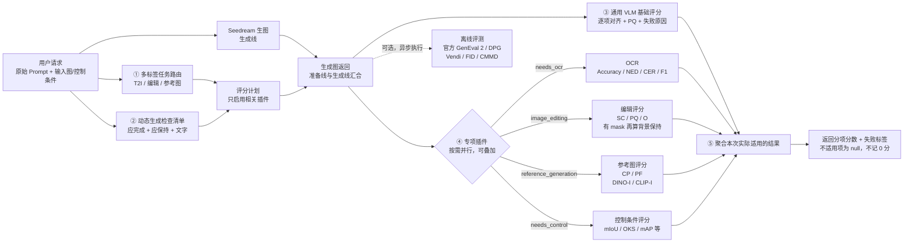

# Seedream 图片生成后的实时机评方案

> 场景：每次 Seedream 生成完成后立即自动评分；请求可能属于文生图、指令编辑、参考图/多模态生成，也可能同时属于多类。全程机评，不依赖人评。

## 一、推荐架构：通用评分 + 多标签路由 + 专项插件



**读图要点：**路由不是单选。一个请求可以同时触发编辑、参考图和 OCR；路由与检查清单在生图期间准备，出图后通用 VLM 与专项插件并行，最后只聚合本次相关分数。

路由器的内部步骤单独见 **[多标签路由工作流](15_Router_Workflow.md)**。

**不要把每次请求强制分到唯一类别。** 例如“保留这只狗的身份，把背景换成月球并给它穿宇航服”同时需要编辑评价和主体保持评价。

---

## 二、为什么不能只靠输出图分类？

任务类型主要由**用户输入和生成意图**决定，而不是由输出图长什么样决定。

### 路由规则

| 输入与意图 | 应触发的评分 |
|---|---|
| 只有文本，没有输入图 | 文生图评分 |
| 有源图，要求增、删、换、改背景、改颜色等 | 指令编辑评分 |
| 有参考图，要求保持某主体/身份/风格并生成新内容 | 参考图评分 |
| 同时要求编辑源图并保持参考主体 | **编辑 + 参考图双路评分** |
| 任意任务中指定标题、招牌、数字、日期等 | 额外触发 OCR |
| 有多张参考图 | 参考图评分 + 多主体遗漏/串换检查 |
| 有姿态、分割、布局等控制条件 | 额外触发条件专用指标 |

“这张图看起来像编辑结果”不是可靠路由依据。必须使用原始 prompt、输入图角色和用户意图。

---

## 三、生成前先做什么？路由与检查清单生成

在 Seedream 生成图片的同时，用 LLM/VLM 处理原始请求，输出结构化路由与检查清单。这样可以把一部分计算隐藏到生成过程中。

### 路由系统提示词示例

```text
你是图像生成评测路由器。根据用户原始指令、输入图像及其角色，
决定需要执行哪些效果评价，而不是评价图像质量。

允许同时返回多个任务：
- text_to_image：纯文本生成图像；
- image_editing：需要修改源图；
- reference_generation：需要保持参考主体、身份或风格并生成新内容；
- needs_ocr：指令包含应准确渲染的文字；
- needs_control：存在明确的姿态、分割、布局、深度等控制条件；
- multi_reference：存在多个需要分别保持的参考主体。

同时生成用于评分的检查清单：
- 文生图：对象、属性、数量、关系、文字等原子条件；
- 编辑：应改变的条件与应保持的条件；
- 参考图：主体保持条件与目标 prompt 条件。

只输出 JSON，不执行评分。
```

### 路由输出示例

```json
{
  "modes": ["image_editing", "reference_generation"],
  "needs_ocr": false,
  "multi_reference": false,
  "needs_control": false,
  "checklist": {
    "task_requirements": [
      {"id": "edit_background", "question": "背景是否变为月球表面？"},
      {"id": "edit_suit", "question": "小狗是否穿着宇航服？"}
    ],
    "preservation_requirements": [
      {"id": "dog_identity", "question": "是否保留参考小狗的身份特征？"}
    ]
  }
}
```

路由不确定或属于混合任务时，**同时运行相关插件**。不适用的结果写 `null`，不要按 0 分处理。

---

## 四、生成后实时执行哪些评分？

### 1. 所有请求都可执行的基础评分

- **任务对齐**：根据动态检查清单逐项验证；
- **感知质量 PQ**：自然度、结构异常、伪影、局部融合；
- **失败标签**：missing_object、wrong_color、wrong_count、wrong_relation、bad_anatomy、background_drift、identity_lost、wrong_text 等。

通用 VLM 评审系统提示词示例：

```text
你是严格的图像生成效果评审器。

你将收到任务类型、原始用户指令、检查清单和带角色标记的图像。
只依据图像中可见的证据评分，不补充不存在的内容。

逐项检查：
1. task_requirements 是否完成；
2. preservation_requirements 是否保持；
3. 图像是否存在结构扭曲、伪影、不自然融合或其他感知质量问题。

每个检查项输出 0 到 1 的分数和简短理由。
感知质量 PQ 输出 0 到 10 的分数。
只输出指定 JSON，不计算数据集均分，不推测生成模型名称。
```

建议输出：

```json
{
  "checks": [
    {"id": "edit_suit", "score": 1.0, "reason": "小狗穿着完整宇航服"},
    {"id": "dog_identity", "score": 0.5, "reason": "保留了毛色，但左耳斑点消失"}
  ],
  "task_alignment": 0.75,
  "PQ": 8,
  "failure_tags": ["identity_detail_lost"]
}
```

`task_alignment` 可由程序对检查项求均值，VLM 不必自己计算。

### 2. 文生图插件

实时任意 prompt 没有官方预生成 QA，因此需要：

1. 在生成前将 prompt 动态拆成原子检查项；
2. 生成后让 VLM 逐项回答；
3. 程序计算平均正确率，并按对象、属性、数量、关系、文字分组。

这属于**在线动态原子评价**。如果只有 0/1 答案，它是二值原子准确率；如果能取得正确答案概率，才可以进一步构造 Soft-TIFA 风格的 AM/GM。

**它不等于官方 GenEval 2 分数，除非使用官方 800 条 prompt、固定 QA 和指定评分协议。**

### 3. 指令编辑插件

- VLM 分别评 **SC、PQ**；
- 程序计算 `O=sqrt(SC×PQ)`；
- 有可靠编辑 mask 时，计算背景 LPIPS/PSNR/SSIM；
- 没有 mask 时，先让 VLM 评“未编辑内容保持”，不要伪造官方 masked PSNR。

自动预测 mask 可以作为辅助，但必须标记为 `estimated_mask`，不能与人工 mask 结果直接混比。

### 4. 参考图与多模态插件

- 单主体：VLM 按 CP/PF 思路分别评主体保持和文本遵循；
- 快速辅助：计算 DINO-I/CLIP-I；
- 多参考：逐个主体评价，计算遗漏率、串换率和全部主体同时正确率；
- 有文字时同时调用 OCR。

不要仅依赖整图 CLIP-I，因为它可能被大面积背景相似度抬高。

### 5. OCR 插件

只要 prompt 指定文字，或需要检查意外幻觉文字，就调用 OCR：

- 单区域：Accuracy、NED、CER；
- 多区域：OCR-F1、整图全部区域正确率；
- 长文本：micro CER；
- OCR 未检出目标文字应作为内容缺失处理，不能从均值中删除。

OCR 与 VLM 评分可以并行。

---

## 五、实时结果建议长什么样？

```json
{
  "request_id": "req_001",
  "modes": ["image_editing", "reference_generation"],
  "scores": {
    "task_alignment": 0.75,
    "PQ": 8.0,
    "edit": {"SC": 8.0, "PQ": 8.0, "O": 8.0},
    "reference": {"CP": 2.5, "PF": 4.0, "DINO_I": 0.71},
    "ocr": null,
    "control": null
  },
  "failure_tags": ["identity_detail_lost"],
  "judge": {
    "model": "exact-vlm-version",
    "system_prompt_version": "judge-v1",
    "router_version": "router-v1"
  }
}
```

前端可显示：

```text
编辑：8.0/10 ｜ 主体保持：2.5/4 ｜ 文本遵循：4.0/4 ｜ 画质：8.0/10
主要问题：左耳身份斑点丢失
```

不需要为了界面强行合成一个跨任务总分。若必须要一个“任务完成度”，可以在同一任务内由检查项计算，但仍保留各专项分。

---

## 六、哪些指标不适合放入实时单图主流程？

| 指标 | 原因 | 推荐位置 |
|---|---|---|
| 官方 GenEval 2 / DPG 全量分 | 依赖固定 prompt 集、固定 QA 和完整评测集 | 离线 benchmark |
| Vendi Score | 需要同 prompt 多张图，单张输出无法计算 | 多 seed 聚合后离线/异步 |
| FID / CMMD / KID | 是集合分布指标，不是单图质量分 | 离线集合评测 |
| 多次重复 VLM 评审 | 增加实时延迟 | 只对抽检样本异步复核 |
| 全量 OCR + 多 VLM + 所有专项模型 | 每个请求都做会浪费计算并增加延迟 | 由路由按需触发 |

实时路径只运行当前样本相关指标；公共 benchmark 与多 seed 分析放到离线任务中。

---

## 七、推荐的最小可行版本（MVP）

先不要一次接入所有论文指标，按以下顺序实现：

### 第一版

1. **多标签路由器**：判断 `t2i/edit/reference/needs_ocr`；
2. **动态检查清单生成器**：生成 task/preservation 检查项；
3. **一个通用 VLM 评分器**：逐项对齐 + PQ + 失败标签；
4. **OCR 插件**：有目标文字时并行运行；
5. **编辑与参考图分支**：分别输出 SC/PQ/O 或 CP/PF；
6. 保存原始输出、结构化分数、路由和 judge 版本。

### 第二版再增加

- DINO-I/CLIP-I；
- 自动或人工 mask 的背景指标；
- 多主体遗漏/串换统计；
- logprobs 可用时的 Soft-TIFA 风格 AM/GM；
- 离线 Vendi 和官方 benchmark。

---

## 八、实时化实施要点

- 路由和检查清单生成与 Seedream 生图**并行**；
- 输出图生成后，VLM、OCR、DINO/CLIP 等插件**并行执行**；
- 使用结构化 JSON 和固定系统提示词版本；
- 缓存相同“输入 + 输出 + judge 版本”的评分结果；
- 保存逐检查项结果，不能只保存最终均值；
- 机评标准持续用固定回归样本检查，防止 VLM 或提示词升级后分数漂移。

**最终建议：实时层做“动态检查清单 + VLM 对齐/PQ + 按需 OCR/编辑/参考插件”；正式论文式 benchmark 和集合多样性指标放在离线层。**
